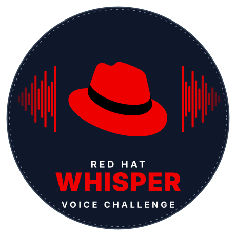

<p align="center">
  
</p>

# Red Hat Whisper Voice Challenge

A multilingual voice transcription tournament for conference booths: attendees
speak challenge phrases, Whisper transcribes them, and a persistent leaderboard
tracks their scores. Flask UI, vLLM on OpenShift AI, SQLite on a PVC.

## Install

Choose the [agent installation](docs/AGENT-INSTALLATION.md) or
[traditional direct Helm installation](docs/HELM-INSTALLATION.md). Both deploy the
same chart. The command below is the automated wrapper used by the agent.

Install from **`main`**. Tournament is enabled by default; set
`tournament.enabled: false` for anonymous standalone play. The former tournament
branch is archived as `archive/tournament-before-consolidation-20261023`; all new
clones should use `main`. Start with the
[installation and operations runbook](docs/INSTALLATION.md), including prerequisites,
credentials, backups, upgrades, troubleshooting and acceptance checks.

```bash
git clone --branch main --single-branch \
  https://github.com/agiertli/redhat-whisper-voice-challenge.git
cd redhat-whisper-voice-challenge

# After oc login as cluster-admin on the prepared RHDP OpenShift AI 3 cluster:
# Owner chooses the first language: cs=Czech, sk=Slovak, de=German, en=English.
./deploy.sh --language cs --free-rhdp-gpu --preflight
./deploy.sh --language cs --free-rhdp-gpu
```

`--free-rhdp-gpu` explicitly stops only RHDP's bundled
`my-first-model/llama-32-3b-instruct`, which normally occupies SNO's GPU. Omit it
when that action is not needed/authorized. Default installation uses the published
versioned UI image: no build engine or registry push permission needed.
Monitoring is a required step and is enabled while preserving existing settings.
The installer requires Bash, `oc`, Helm 3, Python 3 and curl; the separate conference
backup script requires only Bash, curl and standard macOS/Linux utilities.

For a repeatable venue configuration, copy [docs/examples/values-conference.yaml](docs/examples/values-conference.yaml)
and use `--values values-conference.yaml` on every install/upgrade. A first-language choice is
mandatory. Preserve the venue file and run off-cluster backups before admitting
players. Upgrades take a verified backup first and retain installed credentials.

## Install through an agent

[AGENTS.md](AGENTS.md) and [CLAUDE.md](CLAUDE.md) use the same runbook and script.
Use the [copyable installation prompt](docs/AGENT-INSTALLATION.md#copyable-prompt).
Its owner settings are grouped at the top: first required language, registration
mode, namespace, permission to stop the bundled Llama, and admin password choice.
Edit those six lines and copy the full prompt into your agent.

For third-party conferences, choose `registration.mode: username` in the values
file: one username field registers or resumes a player, with no name/email
collection. The default `full` mode keeps the existing registration flow. Both
modes use the same versioned image (`v2.11.0` or newer) and persistence.

## Tournament or standalone

`tournament.enabled: true` is the default. Set it to false for anonymous play
without registration or persistent leaderboards. Both modes use the same image;
switching preserves stored results and credentials. See the
[mode and compatibility guide](docs/customization/game-mode.md).

## Booth operation

Open the game over trusted HTTPS in Chrome/Edge, grant microphone access and use
a USB microphone. Players register, select a difficulty and play multilingual
rounds. The owner-selected required language is used for the **first** challenge.
Use `/tv` for the booth monitor and `/admin` for management, exports and restore.
The admin credential is retrieved privately from the installed Kubernetes Secret.

Keep a separate laptop running [scripts/backup.sh](scripts/backup.sh) during the
conference. Copying that script does not require installing Python, oc or SQLite.
Follow the runbook for protected token transfer, TLS, monitoring backup success,
retention and a restore drill. The PVC is persistence, not a substitute for backups.

## What is essential in this repository?

**To install a published image:** use `deploy.sh`, `helm/` and `scripts/`, following
[the installation runbook](docs/INSTALLATION.md). Start a reusable owner values
file from [the example](docs/examples/values-conference.yaml). `AGENTS.md` is the
agent entry point; `CLAUDE.md` points to it. You do not need a Python development
environment, container build or reporting tools to install.

**To change or build the application:** all runtime code and assets are in `src/`:
`app_streaming.py`, `templates/` and `static/`. The root `Containerfile` and
`requirements.txt` define its image build. Documentation is not copied into the
application image.

**To verify or operate it:** `tests/` contains optional local regression checks and
`tests/audio/` contains smoke-test audio and the older manual audio client.
The installer uses `tests/audio/test-en.wav` for its real-audio smoke check, so
keep that fixture in a deployment checkout. See [tests/README.md](tests/README.md).
`scripts/backup.sh` is the standalone conference backup tool;
`scripts/reporting/` holds optional statistics reporting. These are not application
runtime modules. Dated `docs/validation/` reports record evidence and limitations.
There is no repository-managed GitHub Actions workflow.

For owner changes, use the [customization guides](docs/CUSTOMIZATION.md); for
background, see [architecture](docs/ARCHITECTURE.md).

The [consolidation and branch-retirement plan](docs/BRANCH-CONSOLIDATION-PLAN.md)
records acceptance evidence, remaining follow-up checks and safe retirement of
the older tournament branch.

The deployment runbook/chart take precedence over older background diagrams.
This custom demo is not itself a claim of Red Hat product supportability.

Apache License 2.0. See [LICENSE](LICENSE).
