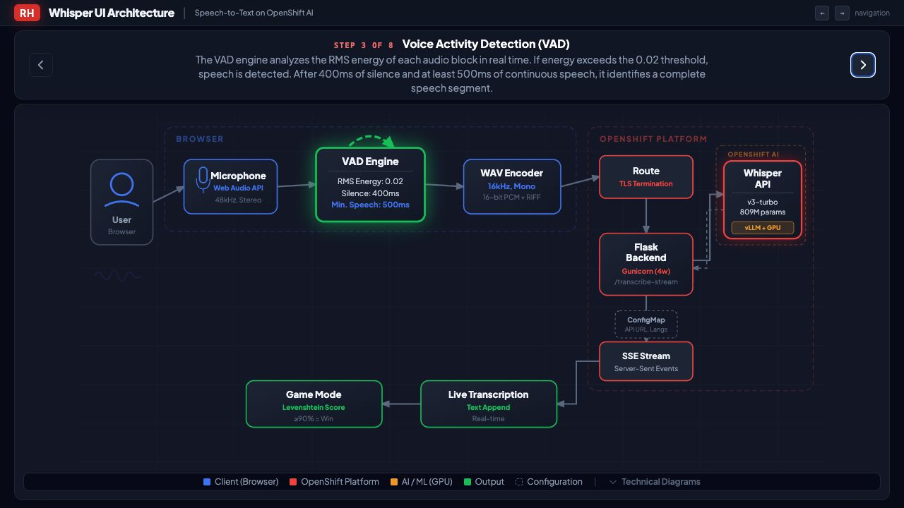

# Architecture tour layout fix — 2026-10-23

## Reproduction and cause

On the live `/architecture` page, advancing from step 2 to step 3 made the caption
wrap onto an extra line. The stepper grew by 20 pixels at the tested 1280×720
viewport, reducing the flex-sized SVG viewport from 526 to 506 pixels high and
moving its top from y=140 to y=160. Step 4 reversed the change. SVG
`preserveAspectRatio="xMidYMid meet"` then rescaled the entire drawing, creating
the apparent zoom around the microphone/VAD section. The viewBox itself never
changed.

The step updater also removed every active-node animation before adding the next
step's highlights, restarting the VAD pulse even though VAD is active continuously
in steps 2, 3 and 4.

## Change

All step descriptions now participate in a shared CSS grid for sizing. Invisible,
`aria-hidden` copies reserve the largest caption height at the current viewport
and font size. Duplicate IDs are removed from those copies. Only the active
caption is visible and exposed to accessibility tools. This avoids fixed pixel
estimates, text clipping and resize handlers.

Highlight updates now toggle each unique flow/node directly into its next state.
Shared active nodes retain their animation rather than being reset first. Original
path widths and arrow markers are retained and restored when inactive, including
the VAD analysis arc's original marker-free state.

## Verification

- Browser measurements reproduced the 20-pixel shift on the previous live page.
- All eight steps in the local fixed page retained x=33, y=160, width=1214 and
  height=506 at 1280×720. Repeated forward/backward arrow-key transitions through
  steps 2–4 and Space navigation also retained those bounds.
- After redeployment, the same eight-step browser check passed on the actual
  HTTPS `/architecture` endpoint. The served/deployed HTML SHA-256 matched the
  repository source.
- Measurements are retained in
  [architecture-layout-measurements.json](architecture-layout-measurements.json).
  This is a measured single-viewport check, not a claim of a complete browser/device
  compatibility matrix.
- All 66 existing regression tests and Helm lint passed locally.
- Published/deployed UI: `quay.io/agiertli/whisper-ui:v2.11.1`, image digest
  `sha256:212936a08f90ee11121d6a01ada1d6b73a480bb47a2c4b1d7e3d7a6cb440dede`.
  Chart: `2.0.0-rc.4`, live Helm revision 7.
- The standard installer took an external backup before upgrading. Model/UI
  readiness, mandatory monitoring, real-audio transcription and request/token
  counters passed. The warmup Job succeeded; its audio request took 14.8 seconds.
- Existing player IDs, best scores, completed-game counts and both credential
  values matched the pre-upgrade baseline. Username-only registration, German
  first language and monitoring remain configured. No tournament data was reset.

