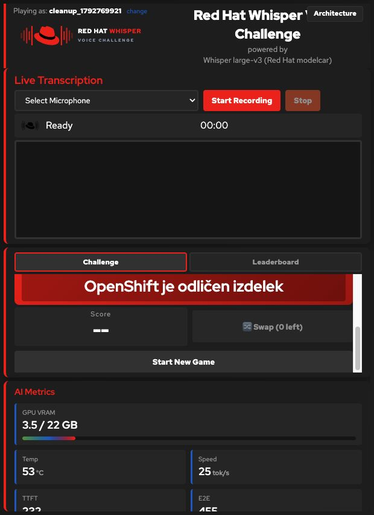

# Repository cleanup and Hard-only Swap — 2026-10-23

## Scope

Runtime Python, templates, logos and the interactive architecture page now all
live under `src/`. The image copies `src/`, not the documentation tree. Existing
public asset URLs are unchanged. The top-level developer requirements, manual
audio collection, venue example and statistics utility have moved to `tests/`,
`docs/examples/` and `scripts/reporting/`. README distinguishes installation,
runtime, test and reporting files. No useful audio fixture or historical report
was removed. The unrequested GitHub Actions installation workflow was removed;
regression checks remain local commands.

New attempts cannot be skipped. Easy/Medium have no Swap; Hard has one Swap that
replaces the challenge without consuming a round. Historical `skip` rows, backup
compatibility and their scoring remain intact. Removed unused win-count state,
CSS and the ineffective `game.winThreshold` setting; the actual 80% threshold is
unchanged. The architecture illustration now also says 80% rather than 90%.
The optional manual audio client uses an argument array instead of `eval` and
verifies TLS (a private CA can use `CURL_CA_BUNDLE`).

## Local verification

- All **70** unittest regression checks passed (macOS/Python 3.14.2).
- New coverage rejects skip/status manipulation without consuming an attempt,
  scores an empty transcription as a failure, restores historical skipped rows
  through the real backup/restore handlers, and serves moved runtime assets.
- Helm 3.15.4 lint passed; rendering old `game.winThreshold` values does not
  reintroduce `WIN_THRESHOLD`.
- Bash syntax and ShellCheck 0.10.0 passed for installer, backup, monitoring,
  GPU-release, access, smoke, reporting and manual audio helpers.
- Active owner documentation links resolve; `git diff --check` and rendered
  application JavaScript syntax checks passed.

## Live RHDP verification

Current cluster was discovered from the logged-in `oc` context (admin), rather
than copied from an old environment file. Used the standard `deploy.sh` preflight
and upgrade with the same owner values, preserving German (`de`) and username
registration. A verified external SQLite snapshot was saved before mutation.

- Published and deployed `quay.io/agiertli/whisper-ui:v2.11.2`, digest
  `sha256:829c6f17944f4d206779aadb05c5cf6d50c977265dc08383d27c1c2632941b31`.
  Chart `2.0.0-rc.5`, Helm revision **8**.
- UI/model Ready; warmup Job succeeded after vLLM became ready at 55 seconds,
  with its warmup inference taking 14.4 seconds.
- Internal real-WAV UI-to-vLLM smoke passed. DCGM gauges and persistent AI
  request/token counters passed. User workload monitoring remained enabled.
- Browser HTTPS registration worked. Easy and Medium exposed no Swap; Hard
  started in German, swapped once, retained round 1/5 and disabled further swaps.
- Public `/logo.svg`, `/favicon.svg` and `/architecture` SHA-256 matched source
  files in their new `src/static/` location. Deployed Python, game template and
  static asset hashes also matched the repository source.
- At all three difficulties, the deployed API rejected new skip submissions,
  then accepted the same attempt index. Five synthetic transcripts per game
  (four perfect, one empty/failure) completed at 80% with a numeric score.
- The published restore endpoint recovered the pre-upgrade snapshot into an
  **isolated temporary database**, verifying integrity, 1 player, 3 games,
  12 attempts and all completed scores. The running database was not restored.
- Both installed credential values matched their private pre-upgrade baseline.
  Every existing player record, best score and completed-game count matched.
  Only the disposable acceptance player and its own games were removed, then the
  original player list was compared again and matched. A second standalone backup
  passed integrity checks; every original row in players, games, attempts and
  settings matched the pre-upgrade snapshot exactly.

## Limits

This is an upgrade test on one RHDP SNO environment, not a new-cluster acceptance
matrix or a Red Hat support certification. The scoring API checks used synthetic
transcripts; the real audio check exercised inference separately. A new complete
five-round spoken browser game was not performed during this cleanup. The earlier
browser/live evidence remains in the [RHDP](RHDP-2026-10-23.md),
[registration](USERNAME-2026-10-23.md) and
[architecture](ARCHITECTURE-2026-10-23.md) reports. There is no claim that the
proposed tournament feature flag or branch consolidation has been implemented or
tested by these checks.

