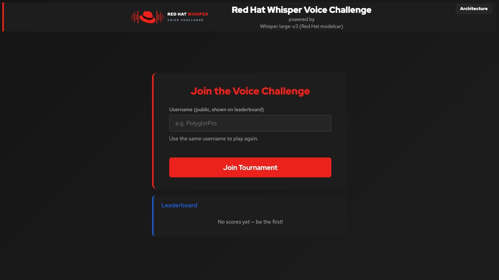
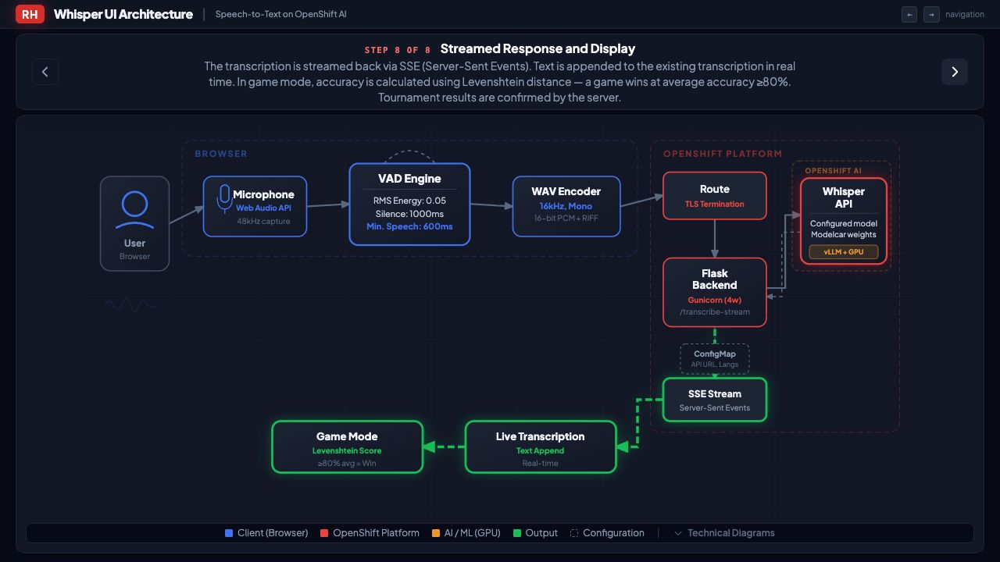

# Consolidation candidate acceptance — 2026-10-23

**Candidate, not a promotion approval.** Work is on `codex/consolidate-modes`.
Neither `main` nor `tournament-mode` has been merged or deleted. External owners
should continue using the accepted branch until the manual gates below pass.

## Scope and recoverability

One chart/image now supports `tournament.enabled: true` (default) and anonymous
standalone play with `false`. Registration remains independently configurable as
`full` or `username`. Switching modes retains the PVC, Secret and historical data.
Disabled tournament routes reject calls, including previously valid player tokens.
Protected administration and backup remain available in both modes.

The only schema addition is nullable `games.round_count`. New games require all
their configured rounds before completion; legacy rows retain their historical
rules and scores. Save retries are idempotent, conflicting retries fail, and the
browser retains pending saves rather than silently advancing. Restore validates
the SQLite schema/integrity before replacing data. Historical scores are not
recomputed.

Recovery tags were pushed and cloned independently:

- `archive/main-before-consolidation-20261023`: `b1c38ed493e90ffdb1aa2105c84f20320e765990`.
- `archive/tournament-before-consolidation-20261023`: `8e0292432afdb85398ee4fe9a03978171950d67d`.

## Local checks

88 automated regression tests passed on macOS, Python 3.14.2, Bash 3.2.57 and
Helm 3.15.4. Tests cover both modes, explicit false/default/invalid configuration,
registration, endpoint guards, additive legacy migration, scoring, concurrent
attempt retries, completion retries, malformed requests, restore rejection and
rendered frontend save/session transitions. Node's built-in VM exercises the
actual rendered JavaScript functions; these are not microphone/browser tests.
Focused restore tests also reject corrupt, truncated and incompatible snapshots.
Helm lint, shell syntax, ShellCheck 0.10.0 and architecture JavaScript syntax pass.
No GitHub Actions workflow was introduced.

## Fresh RHDP cluster checks

Environment: OpenShift 4.20.42, RHOAI 3.5.2, NVIDIA GPU Operator 25.3.4, single
node and NVIDIA L4. German (`de`), username registration, tournament enabled is the
final intended owner configuration. Cluster credentials and snapshots remain
private outside Git. The previously used cluster was not modified.

Completed checks during candidate iteration:

- Standard wrapper installation on the fresh cluster; authorized bundled Llama
  scaled to zero, monitoring enabled and verified, model warmup succeeded.
- Real WAV transcription through UI → model returned “That's one small step for
  man, one giant leap for mankind.” DCGM GPU gauges and persistent AI counters
  were verified. This proves inference independently of browser capture.
- Standard upgrade to standalone: public tournament surfaces return 404, no
  registration form, protected history/backup works; all database rows unchanged.
- Direct Helm upgrade to tournament/full registration: required fields and
  resuming an existing username player verified.
- Three five-round API games across Easy, Medium and Hard: 80% average wins,
  invalid/Skip/out-of-order requests fail, concurrent identical retries do not
  duplicate attempts, repeated completion returns the persisted result.
- Rollback with the independently cloned accepted `v2.11.2` release, followed by
  upgrade back to the candidate: PVC/Secret identity, credentials, existing token,
  historical scores and baseline player/game/attempt/settings rows preserved.
  The old release could create a legacy game with the added column present.
- Published restore endpoint exercised in a separate process against an isolated
  temporary database: a legacy-schema snapshot migrates, counts/scores/integrity
  match, and an incompatible restore fails without changing that temporary data.
  The running tournament database is not used as a restore target.
- A fresh Git clone and clean environment (no `now.env`, virtualenv or prior
  repository memory) completed standard preflight and repeat upgrade at `77910c5`.
- Browser HTTPS, the single username form, resume, required German first round,
  one Hard Swap and its absence on Easy/Medium verified.

Browser captures: [standalone play](integration-standalone.png) and
[tournament Hard Swap](integration-tournament.png).

Two earlier internal smoke executions encountered API exec TLS bad-record-MAC
transport errors after deployment. Verification correctly failed rather than
claiming success. The helper now streams its input and retries only recognized
transient transport failures up to three times; application assertions are not
retried. Live verification and the clean-clone repeat subsequently passed with
certificate verification enabled.

Final published candidate: chart `2.0.0-rc.7`, UI `v2.12.0-rc.4`, digest
`sha256:73f18b0c4c7f4ce19560b68438baf4f1c855eae18ab089375db7355399fdd13f`.
The final static architecture labels now match the 80% win rule and current VAD
constants; earlier mode/rollback checks used preceding candidate tags.

Final wrapper upgrade completed at Helm revision **8**: warmup hook `Succeeded`,
real-audio transcription and DCGM/persistent AI checks passed (12 requests and
121 tokens at verification). Published Python, game template and architecture
asset SHA-256 hashes matched the working source. PVC identity and both Secret
credential values matched the original fresh-install baseline. Both sets of
baseline scores, tokens and rows remained unchanged before cleanup.

At 1280×720 the architecture SVG retained identical bounds on all eight forward
steps and reverse navigation through steps 7–2: x=33, y=160, width=1214,
height=506. A deleted disposable player's stale browser session returned to the
single-field registration screen after the next game-start request. Only the
three identified acceptance players and their games were removed afterward;
unrelated records were compared and preserved. The fresh cluster has no players.

One external backup downloader ran with `env -i`, `PATH=/usr/bin:/bin` and
macOS Bash 3.2: no Python, `oc`, virtualenv or repository configuration. The default
300-second loop saved snapshots at **18:43:39Z** and **18:48:41Z**, sequentially.
Both passed script format/length checks and an independent SQLite integrity check;
files were mode 600. The test loop was stopped after the second snapshot. Before
admitting real players, the owner must start their conference laptop's backup
loop and keep that laptop awake; no ongoing backup service is claimed here.

## Remaining acceptance gates

1. A technical owner must play an actual five-round spoken game in a supported
   conference browser, including microphone permission/capture, final score and
   refresh/resume. In-app browser microphone permission could not be controlled;
   Chrome was unavailable to this test session. Real WAV and synthetic API games
   are separate evidence, not a substitute for this check.
2. Rehearse a live upgrade from the older `main` release. Rendered selectors and
   route targets are compatible, but its older model/runtime differs. Follow
   [the migration guide](../customization/upgrading-existing-installations.md).
3. Have an independent technical owner follow the documentation without this
   chat, check their intended language/registration choice and rehearse recovery.
4. Before promotion, refresh Git ancestry, review the final diff, switch candidate
   branch references in installation docs to `main`, and repeat release checks.
   Keep recovery tags/images and both accepted branches through acceptance.

No finite test suite establishes zero risk. This evidence supports a reviewable
integration candidate; it does not justify deleting the accepted branch today.
