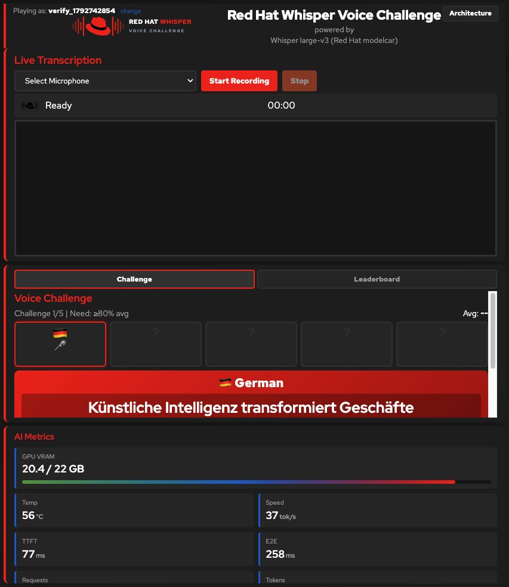

# RHDP live installation acceptance — 2026-10-23

## Scope and outcome

The agent/installer and direct Helm procedures were exercised on the same live
RHDP environment within the requested 40-minute window. The final installation
uses German (`de`) as its first challenge language, with monitoring enabled.
This verifies this baseline; it is not a claim that every OpenShift/operator
combination or conference laptop has been tested.

- OpenShift 4.20.42, OpenShift AI 3.5.2, NVIDIA GPU Operator 25.3.4.
- Single-node OpenShift with one NVIDIA L4; namespace/release `whisper`.
- Chart `2.0.0-rc.2`, published UI `quay.io/agiertli/whisper-ui:v2.10.0`.
- Runtime `registry.redhat.io/rhaiis/vllm-cuda-rhel9:3.2.4`, reporting
  vLLM `0.11.0+rhai5`.
- Modelcar `oci://registry.redhat.io/rhai/modelcar-openai-whisper-large-v3:3.0`.
- SQLite PVC: 1 GiB, `gp3-csi`; UI runs under `restricted-v2` SCC.
- Live UI: https://whisper-ui-whisper.apps.ocp.qwj5h.sandbox2855.opentlc.com/

## Problems found and incorporated

1. **Published image mismatch.** The previous default, `v2.2.0`, lacked the
   registration page expected by this branch. The default now uses the existing
   `v2.10.0` image. Its `/app/app_streaming.py` SHA-256 matched the repository
   source exactly:
   `c619533ab0b5e30a2a530f9a3744b3295dd220bf470e4d25ebdba157abd0a3a5`.
   No application source change, image build or image publication was needed.
2. **Cold SQLite initialization race.** Four Gunicorn workers could initialize
   a new database concurrently and fail with `database is locked`. The chart now
   supplies `GUNICORN_CMD_ARGS=--preload`, initializing before workers fork.
   Three isolated cold starts with fresh databases and four workers each passed.
3. **Monitoring prerequisites.** Monitoring is mandatory for both procedures.
   The shared Bash helper enables user workload monitoring using Helm's YAML
   parser, preserves other ConfigMap settings and checks resourceVersion when
   replacing an existing ConfigMap. An already enabled configuration is a no-op.
   The installer waits for Prometheus; smoke checks require both positive DCGM
   gauges and persistent request/token counters. They allow scrape convergence
   and repeat the real request when a new counter baseline needs another sample.

## Checks passed

- Read-only installer preflight, followed by the authorized deployment.
- Exact RHDP bundled Llama release: `my-first-model/llama-32-3b-instruct`
  patched/scaled to zero, its GPU pods terminated, and Whisper acquired the GPU.
- Model image pull, KServe readiness, warmup, UI readiness, PVC binding and TLS.
- Controlled warmup deadline failure: Helm reported failure and emitted useful
  diagnostics without deleting the model, UI or PVC. A normal subsequent upgrade
  recovered the release; no uninstall or database deletion was needed.
- Installer upgrade and direct `helm upgrade --install` using explicit values.
- Actual English WAV fixture through UI → vLLM returned:
  “That's one small step for man, one giant leap for mankind.”
- Synthetic player registration, game start, five attempts, completion and public
  leaderboard: the perfect supplied transcripts produced an easy score of 119.9.
  This exercises the scoring API, not human microphone capture.
- Existing signing/admin credentials, player token, score and PVC identity
  survived upgrades and a UI rollout restart.
- Language persistence was checked across upgrades. A deliberate temporary French
  configuration was applied and then restored to the owner's German selection.
  The browser displayed a German first challenge after restoration.
- User workload Prometheus became ready; KServe's ServiceMonitor target reported
  `up=1`, the UI service account could query Thanos, and the UI showed GPU memory,
  temperature, request and token data. The final smoke check reported 5 requests
  and 51 tokens; counters naturally continue changing.
- Standalone Bash backup downloaded two 45,056-byte snapshots at 08:10:40 and
  08:15:41 UTC, demonstrating the five-minute loop. One-shot pre-upgrade backups
  also succeeded. The loop was stopped after validation; the conference owner
  must start it on the designated backup laptop before admitting players.
- An actual downloaded snapshot was restored through the application's restore
  endpoint into a separate temporary database. SQLite integrity, 1 player,
  2 games, 5 attempts, scores and leaderboard were verified. The live database
  was not replaced during this rehearsal.
- 52 offline regression tests and Helm lint passed locally. The CI workflow runs
  regression checks on Linux and macOS and ShellCheck on Linux.

The isolated runtime checks are reproducible from the repository:

```bash
oc exec -i deployment/whisper-ui -n whisper -- \
  python3 -c "$(cat tests/live_cold_start_check.py)"

# Use an actual snapshot downloaded by scripts/backup.sh.
oc exec -i deployment/whisper-ui -n whisper -- \
  python3 -c "$(cat tests/live_restore_check.py)" < /path/to/snapshot.db

./scripts/verify-install.sh whisper de
```



## Remaining acceptance work

- A human must test the actual booth microphone, browser permission flow and
  speech quality in the venue's acoustic conditions.
- A full cluster-loss recovery onto a replacement cluster/PVC was not performed.
  The isolated restore proves snapshot usability, not the entire disaster plan.
- The final chart was upgraded onto the recovered installation. It was not
  independently installed again onto a second clean cluster; fresh-database
  worker initialization was tested separately as described above.
- The standalone backup ran on this macOS machine, not a freshly imaged physical
  laptop. It requires Bash, curl and standard system utilities, with no cluster
  CLI, Python, jq, SQLite CLI, package installation or container engine.
- No independent agent with empty history performed a separate installation.
  The repository now supplies both self-contained entry points, but another
  owner's rehearsal remains valuable evidence of handover quality.
- This SNO/SQLite arrangement has planned upgrade downtime and no high
  availability. Off-cluster backups limit loss to the last successful snapshot;
  a five-minute schedule does not guarantee zero lost results.

Credentials and private local verification artifacts are excluded from Git.
The synthetic verification player and its games, and the temporary image-check
pod, were removed after testing. No other player data was deleted.
