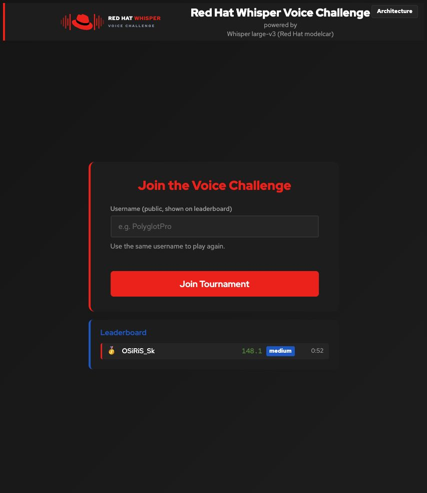

# Username-only feature acceptance — 2026-10-23

The feature remains on `tournament-mode` behind `registration.mode`, without a
separate branch or separate image variant. Chart default: `full`. The live RHDP
installation was explicitly configured to `username`, retaining German (`de`).

## Published and deployed

- Chart `2.0.0-rc.3`, UI `quay.io/agiertli/whisper-ui:v2.11.0`, Linux amd64.
- Deployed image digest:
  `sha256:40b9a8642885184b3fbe789ac5bdb09dff925b3367fc88305ef46bd1ec356298`.
- Cluster/operator/runtime baseline remains as recorded in
  [the initial RHDP report](RHDP-2026-10-23.md).
- Deployed application and index-template SHA-256 hashes matched the local source.
- Existing player IDs, best scores and completed-game counts matched the baseline
  after the upgrade and after synthetic test cleanup. Signing/admin credentials
  were unchanged by the feature upgrade. The owner-requested admin password change
  was performed beforehand with a backup and was successfully authenticated.
- User workload monitoring remained enabled; Llama remained at zero replicas.

## Verification

- 66 offline regression tests passed, including both real Flask registration
  routes/templates, malformed inputs, concurrent username joins, no stored personal
  fields in username mode, mode switching, existing scores/tokens, backup/export,
  scoring examples, skip handling and wrong-mode smoke-test detection.
- Helm lint passed for full and username modes. All three YAML examples in the
  dedicated customization guides rendered/linted successfully.
- Bash syntax passed; ShellCheck 0.10.0 passed for the changed shell scripts.
- Disposable local image/browser checks covered default full registration and
  username registration/resume, Enter submission, and resetting the username when
  changing players. A browser startup ordering error found during this check was
  fixed before image publication.
- The normal installer performed a verified external pre-upgrade backup, then
  upgraded the live release. UI, model, monitoring and real-audio smoke checks
  passed. The audio fixture returned the expected first-step-on-the-moon sentence.
- The post-upgrade warmup Job completed successfully: 81 seconds including waiting
  for readiness, with its audio warmup request completing in 14.7 seconds.
- The live browser displayed one form/one username field, resumed a synthetic
  player using Enter, and displayed German as the first challenge.
- Live API verification registered/resumed the same player ID and confirmed that
  submitted name/email fields were discarded. A synthetic five-attempt game
  completed at 119.9 points using supplied perfect transcripts. This is an API
  scoring check, not a human microphone test.
- An actual new-version backup restored through the application handler into a
  separate temporary database. Integrity, 2 players, 5 games, 17 attempts and
  scores matched. That snapshot includes the synthetic test data and is private.
  The live database was never replaced during this drill.
- Only the synthetic player and its games were removed afterwards. Original event
  results were retained; no result reset or PVC deletion was performed.

## Owner documentation

The [customization index](../CUSTOMIZATION.md) links dedicated guides for
registration, first language and phrases, difficulty groups (including the exact
11/21/29 default pools), tournament scoring, admin passwords and backups/recovery.
Both installation approaches link this index. The agent prompt groups editable
settings at the top and accepts language names/codes and literal admin passwords
or private password files.

## Limits

Human microphone capture and a complete replacement-cluster recovery are still
manual acceptance work. Existing personal data is retained when switching to
username mode; the feature prevents new name/email collection, not historical
storage cleanup. Language-selection quotas and scoring multipliers retain the
existing application behavior, documented separately rather than changed here.
